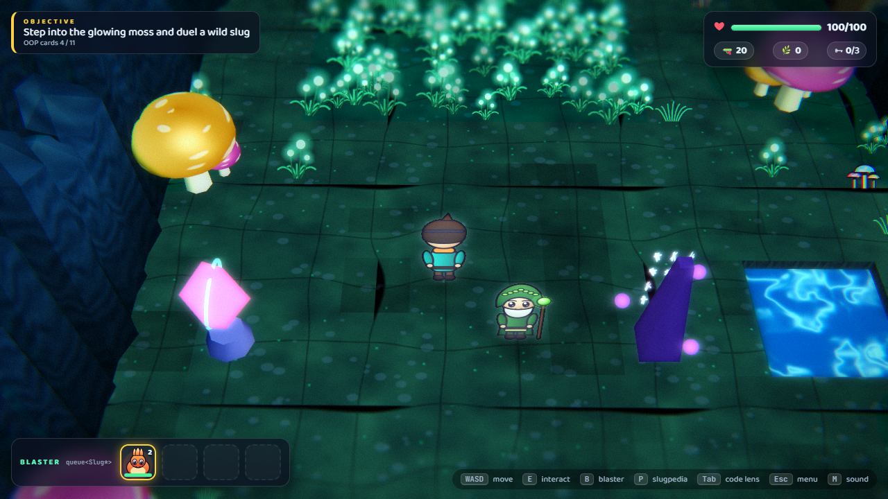
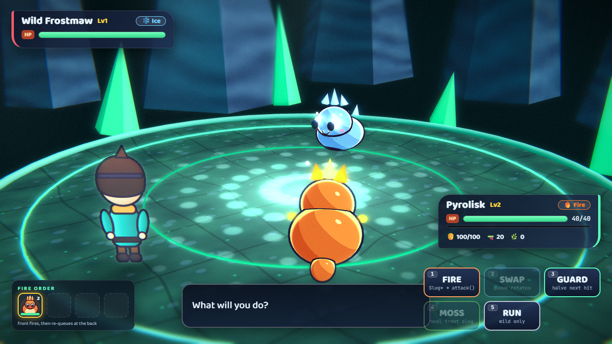
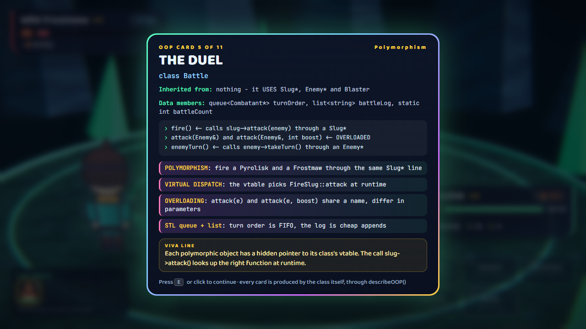
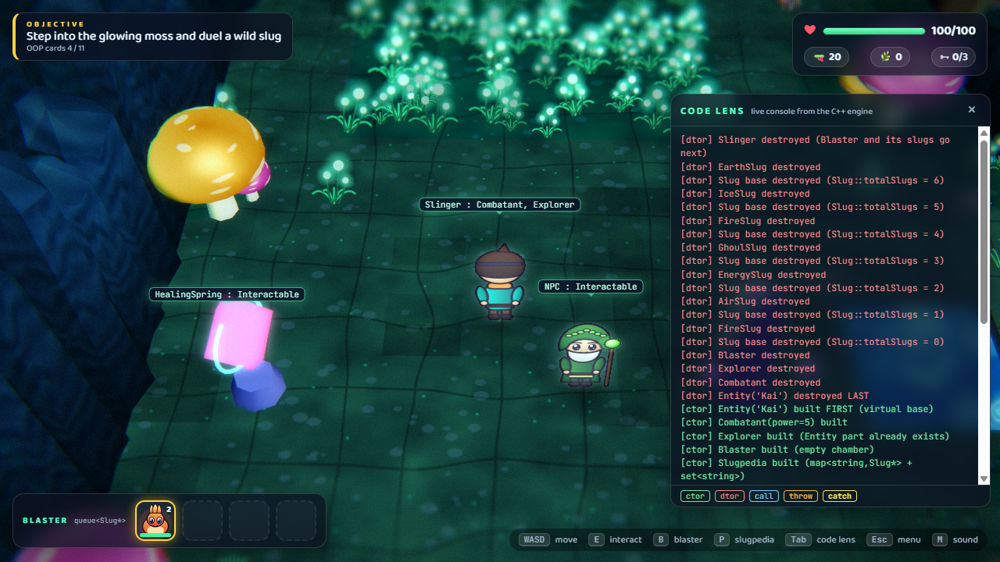
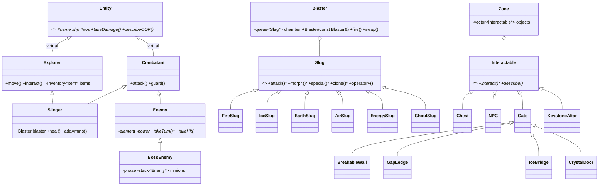

# SLUGBOUND

*Explore the dark. Load your slugs. Take back the light.*

A 2.5D **HD-2D** exploration-and-duel game for the Object Oriented Programming course (C++). A **C++ engine** runs every rule.
A **Babylon.js** frontend draws it: real 3D terrain, lit and shadowed sprites, toon-shaded 3D slugs, fog, coloured lights, glow and tilt-shift.
Every system in the game exists to demonstrate an OOP concept, and the game **teaches the concept live** through OOP Cards and a Code Lens.

**Play it:** https://siddhu2606.github.io/slugbound/

| | |
|---|---|
|  |  |
|  |  |

## How it works

```
┌──────────────────────┐   JSON in / JSON out   ┌───────────────────────┐
│  Browser (Babylon)   │ ─────────────────────► │   C++ engine          │
│  draws, animates,    │                        │   all rules, objects, │
│  plays sound         │ ◄───────────────────── │   battles, saves      │
└──────────────────────┘  "40 dmg, super eff."  └───────────────────────┘
```

* **The frontend never decides anything.** It sends player input (`/move`, `/fire`, ...) and animates what C++ answers.
* On the hosted page the **same C++ source is compiled to WebAssembly** (GitHub Actions, Emscripten) and runs inside your browser, so no server is needed.
* Locally the same engine also runs as a **native HTTP server** (`httplib`) and as a **text console game**.

## Run it

```bash
./build.sh test      # C++ unit tests (diamond, deep copy, fusion, unwinding, saves, boss stack ...)
./build.sh play      # native engine + web page on http://localhost:8080/index.html?server
./build.sh console   # play in the terminal: type  /state   /move {"dir":"up"}
./build.sh bot       # a bot plays the whole game through the API (needs `play` running)
./build.sh wasm      # compile the engine to WebAssembly into web/engine (needs Emscripten)
```

Needs only `g++` (C++17) for the engine. The browser part is plain JavaScript, with Babylon.js vendored in `web/vendor/`.

## Controls

| Key | Action |
|---|---|
| `WASD` / arrows | walk |
| `E` / `Space` | talk, open, interact |
| `B` | blaster: load up to 4 slugs, FRONT fires first |
| `P` | Slugpedia |
| `Tab` | **Code Lens**: class tags over every object + live console of `[ctor] [dtor] [call] [throw] [catch]` |
| `Esc` | menu: save, load, quality (Low / Medium / High), sound |
| `1`-`5` | in a duel: fire, swap, guard, moss, run |

## The game

* **4 zones:** Glowmoss Grotto (tutorial), Crystal Hollows, Magma Vein, Gorvax's Keep. About 12 to 15 minutes.
* **6 slugs:** Pyrolisk (Fire), Frostmaw (Ice), Boulderback (Earth), Zephyra (Air), Voltick (Energy), Umbrafang (Ghoul, **fusion only**).
* **Element wheel:** Fire → Ice → Air → Earth → Energy → Fire. Next element = **2x**, previous = **0.5x**.
* **Blaster = a queue.** The front slug fires, then re-queues at the back. Slugs that faint leave the blaster.
* **Ability gates:** the slug that opens a gate must be *in your blaster*. Earth smashes walls, Ice freezes lava and water, Air glides across chasms, Energy powers crystal doors. The wrong loadout means a locked gate.
* **Boss, Gorvax:** phase 1 shield element rotates every 2 turns. Phase 2 summons a *stack* of minions (top one absorbs each hit). Phase 3 telegraphs a mega attack: guard or lose half your HP.
* **11 OOP Cards** pop up as you play (tutorial in the Grotto). Each card is produced by the class itself through a virtual `describeOOP()`.

## Where each OOP concept lives

| Concept | Where | Why it is built that way |
|---|---|---|
| **Virtual inheritance, the diamond** | `engine/entities.h`, `engine/slinger.h`: `Entity` ← `Combatant`, `Explorer` ← `Slinger` | A Slinger fights *and* explores. `virtual public Entity` gives it ONE `hp`. `Slinger`'s constructor builds `Entity` itself. |
| Single / multilevel / hierarchical inheritance | `Slug` → five elements; `Entity` → `Combatant` → `Enemy` → `BossEnemy` | `engine/slugs.h`, `engine/enemy.h` |
| **Abstract classes, pure virtual** | `Slug` (`attack`, `morph`, `special`, `clone`, `describeOOP`), `Interactable` (`interact`, `describe`) | The battle never says `if (element == FIRE)`. A new slug is a new subclass. |
| **Polymorphism, virtual dispatch** | `Battle::fire()` calls `slug->attack(enemy)` on a `Slug*`; `Battle::enemyTurn()` calls `enemy->takeTurn()` | `engine/battle.cpp` |
| **Virtual destructors** | `delete` on a `Slug*` / `Enemy*` prints `[dtor] FireSlug` then `[dtor] Slug` | Visible in the Code Lens console |
| **Up / downcasting** | `Zone` stores `Interactable*`; `dynamic_cast<BreakableWall*>` in `Zone::interact`; `Explorer::interact` downcasts to `Slinger*` | `engine/world.cpp` |
| **Copy constructor, deep copy, `clone()`** | `Blaster(const Blaster&)` clones every `Slug*`. A `Battle` snapshots your blaster and restores it if you black out. | `engine/slugs.cpp`, `engine/battle.cpp` |
| **Templates** | `Inventory<T>` (`Slug*`, `Item`, `Keystone`), `Registry<T>` (`Zone*`), `clampValue<T>`, `findMax<T>` | `engine/templates.h` |
| **Operator overloading** | `Slug + Slug` = fusion (returns `new GhoulSlug`), `>`, `==`, `++`, `+=`, `<<`, `>>` (reads the Slugpedia text) | `engine/slugs.cpp` |
| **STL** | `queue` blaster and turn order, `stack` boss minions, `map` + `set` Slugpedia, `vector<Interactable*>` zones, `list` battle log, `sort`/lambdas | each chosen for its access pattern |
| **Exceptions and stack unwinding** | `GameException` hierarchy. `Gate::interact` throws `GateLockedException`; two `ScopedLogger` locals print `[dtor]` in reverse order before `[catch]` | try it: walk into the chasm with no Air slug |
| **Binary file handling** | `SaveManager`: magic number, version, fields one by one, a type tag per slug and `Slug::fromFile()` for polymorphic loading. Short or bad files throw `SaveCorruptedException`. | `engine/save.cpp` |
| `friend`, `static`, overloading, `this`-chaining, `const` | `DamageCalculator` (friend, `static calcCount`), `Slug::totalSlugs`, `attack(e)` / `attack(e, boost)`, `heal(10).addAmmo(2)` | |

### Viva one-liners

* *Virtual inheritance makes `Combatant` and `Explorer` share one `Entity`, so `Slinger` has one `hp`, not two. The most derived class initialises the virtual base.*
* *A pure virtual function makes `Slug` abstract, so every element must override `attack()`. The compiler enforces that.*
* *I serialise field by field with a type tag, because `Slug*` is polymorphic and a raw `sizeof` write would store a vtable pointer.*
* *When an exception is thrown, C++ destroys every local between the `throw` and the `catch`, in reverse order. Our console shows that order.*

More questions and answers are in [docs/DESIGN.md](docs/DESIGN.md#10-viva-prep).

## Project layout

```
engine/    the C++ game (graded part): one small file per area
  common.h/.cpp      elements, positions, Logger, exceptions, JSON helpers
  templates.h        Inventory<T>, Registry<T>, clampValue<T>, findMax<T>
  entities.h/.cpp    Entity (virtual base), Combatant, Explorer
  slugs.h/.cpp       Slug hierarchy, Blaster, Slugpedia, operators
  enemy.h/.cpp       Enemy, BossEnemy, DamageCalculator (friend)
  slinger.h/.cpp     Slinger (the diamond)
  world.h/.cpp       Interactable family, Zone, WorldMap, the four maps
  battle.h/.cpp      the duel
  save.h/.cpp        binary saves
  game.h/.cpp        GameEngine::handle(route, json), the one entry point
server/    native HTTP server (cpp-httplib)         console/   text-mode game
wasm/      WebAssembly entry point                  tests/     C++ unit tests
tools/     bot that plays the whole game            web/       Babylon.js frontend
docs/      design document and UML
```

## Class hierarchy (UML)



## How it differs from the plan

* The hosted game runs the C++ engine as **WebAssembly in the browser** (no server to keep alive). The native HTTP server is still there for local runs.
* The world container is called `WorldMap` (a class named `World` inside `namespace World` would be confusing).
* All art is **painted in code** (canvas sprites, procedural textures, geometry built from the zone layout, WebAudio music), so there are no image or sound files to license. 3D models are built from primitives with a toon shader and inked outlines.
* A fainted slug stays in storage until healed; the `[dtor]` lines come from releasing slugs, fusing, and from every duel (the `Battle` deletes its `Enemy*` and its backup `Blaster`).

## Credits

Original world and creatures (Slugterra-*inspired* only in spirit). [Babylon.js](https://www.babylonjs.com/) for rendering, [cpp-httplib](https://github.com/yhirose/cpp-httplib) for the local server.
