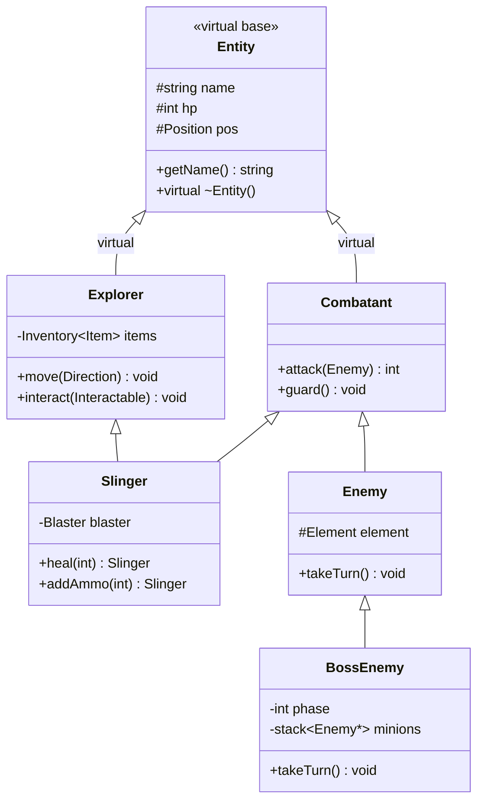
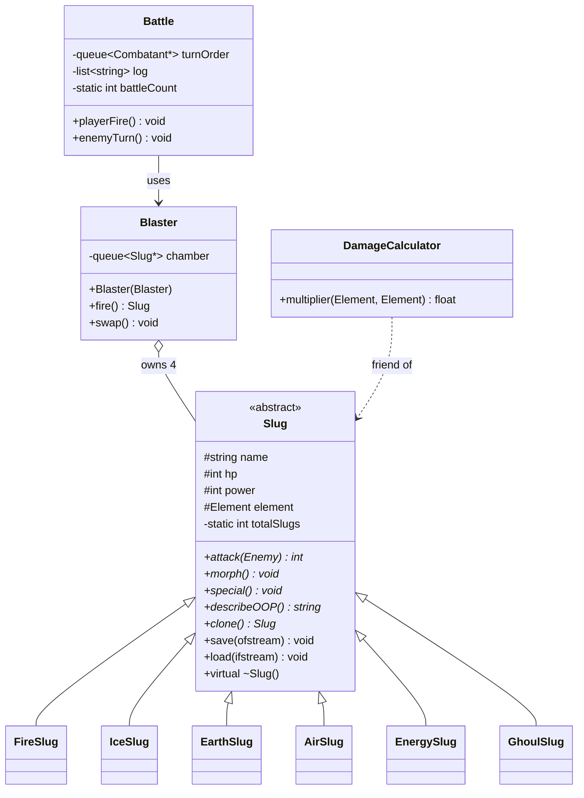
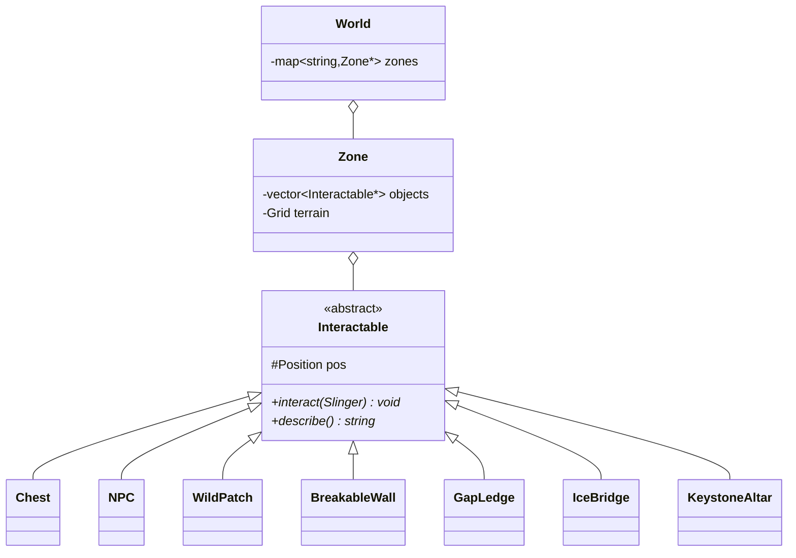
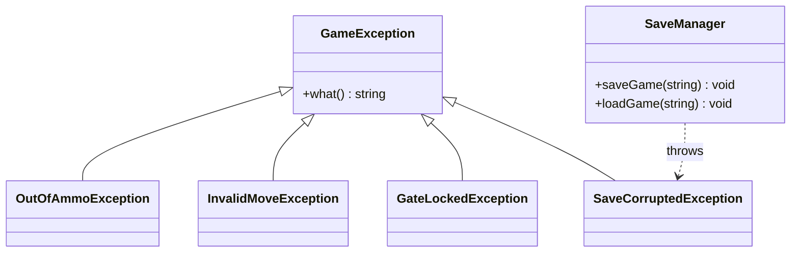
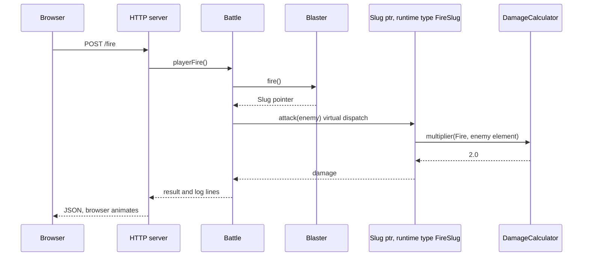

> **Design document.** This is the original plan the project was built from. The game in this repository follows it,
> with a few honest changes listed in the main [README](../README.md#how-it-differs-from-the-plan) (for example the
> hosted version runs the C++ engine as WebAssembly instead of a server, and `World` became `WorldMap`).

# SLUGBOUND

*Explore the dark. Load your slugs. Take back the light.*

A 2.5D HD-2D exploration-and-duel game where a **C++ engine** runs every rule and a **browser frontend** (Babylon.js) makes it beautiful. Every system in the game exists to demonstrate an OOP concept, and the game teaches that concept live, through OOP Cards and a Code Lens.

Built as an Object Oriented Programming course project (C++, group project, A.Y. 2026-27).

---

## 1. Project decisions at a glance

| Topic | Decision |
|---|---|
| Course | Object Oriented Programming in C++ |
| Project type | Group project, demo-level game |
| Game title | **Slugbound** (original world, Slugterra-*inspired*) |
| Design principle | **OOP first.** Each system exists because it shows a concept. Section 4 explains why. |
| Backend | C++ (the graded part): all rules, objects, saves |
| Frontend | Browser, **Babylon.js**, **2.5D HD-2D** |
| Visual style | Real 3D terrain and props, lit sprites with real shadows, 3D toon slugs in battle, tilt-shift + fog + coloured lights |
| Scope | Small open world, 4 zones, 6 slugs, 1 boss, about 12 to 15 min |
| OOP teaching | 11-step tutorial with OOP Cards, plus Code Lens and live console |
| Code style | Simple classes in the style of the course sample (`using namespace std`, plain `cout`) |
| Glue | cpp-httplib (HTTP server) + nlohmann/json, both single-header |

**Golden rule:** the frontend never decides anything. It sends player input to C++, C++ answers what happened, the browser animates it. If damage, turn order or movement is calculated in JavaScript, the C++ becomes decoration and marks are lost.

---

## 2. Story

Deep underground lies **Hollowdeep**, a cavern world lit by the **Heartcrystal**. The Ghoul warlord **Gorvax the Hollow King** has stolen its power and the caves are going dark. You are a young **Slinger** with a beat-up blaster and one slug. Find 3 keystones, break into Gorvax's Keep, and take the light back.

---

## 3. Gameplay

### World (4 zones)

| Zone | Feel | Contents |
|---|---|---|
| **Glowmoss Grotto** | Calm, bioluminescent | Tutorial, Old Mossback (mentor), first slugs, chest, fusion stone |
| **Crystal Hollows** | Echoing, icy blue | Cracked walls, ice bridge, Keystone #1 and #2 |
| **Magma Vein** | Orange, dangerous | Tougher enemies, lava gap, Keystone #3, rival Slinger |
| **Gorvax's Keep** | Dark, red-lit | Final boss, unlocked with 3 keystones |

Movement is free (WASD) with a following camera over real 3D terrain.

### Slugs

| Slug | Element | Combat role | Exploration ability |
|---|---|---|---|
| **Pyrolisk** | Fire | Heavy hit, burns over time | n/a |
| **Frostmaw** | Ice | Slows enemy | Freezes lava into a bridge |
| **Boulderback** | Earth | Shields you | Smashes cracked walls |
| **Zephyra** | Air | Hits twice | Glides across gaps |
| **Voltick** | Energy | Chance to stun | Powers crystal doors |
| **Umbrafang** | Ghoul (rare) | Huge damage | Fusion only |

**Element wheel:** Fire → Ice → Air → Earth → Energy → Fire. Hitting the next element is **Super Effective** (2x). The reverse is **Resisted** (0.5x).

### Combat (turn-based side-view duel)

Your **blaster** holds **4 slugs in a queue**. Each turn:
- **Fire:** the front slug flies out, morphs on impact and deals damage, then goes to the back of the queue
- **Swap:** rotate the queue (costs the turn)
- **Guard:** halve the next hit

Slugs that run out of HP faint and leave the blaster. An empty blaster cannot fire, so loadout and order matter.

### Exploration

- **Wild patches:** random encounters in glowmoss, duel to catch the slug
- **Chests:** healing moss, ammo, keystones
- **NPCs:** Mossback (quests), a trader (swaps slugs)
- **Ability gates:** the slugs in your loadout decide what you can pass. The wrong loadout means a locked gate
- **Rival Slinger** in Magma Vein
- **Hidden rare slug** for players who explore the corners

### Fusion

At Mossback's fusion stone, combine two slugs into a **Ghoul slug (Umbrafang)**. It is the strongest slug, but the two slugs used are lost.

### Boss: Gorvax

1. **Phase 1:** shield element changes every 2 turns
2. **Phase 2:** summons a stack of Ghoul minions; the top minion absorbs each hit and is removed
3. **Phase 3:** red warning glow, then a mega-attack. Guard or lose half your HP

Victory relights the Heartcrystal and the credits list the OOP concepts used.

---

## 4. The OOP design: why each system exists

Each concept below has the same three parts: **where** it lives in the game, **why** it is built that way, and a **viva line** you can say out loud.

### 4.1 Foundations (the supporting cast)

| Concept | In the game |
|---|---|
| Constructors | default, parameterized, initializer lists, and a **deep copy constructor** for `Blaster` |
| Destructors | free dynamic slug memory; each prints a `[dtor]` line to the live console |
| `static` members | `Slug::totalSlugs`, `Battle::battleCount` |
| `friend` class | `DamageCalculator` reads private element/power data of `Slug` and `Enemy` |
| `this` chaining | `player.heal(10).addAmmo(2)` |
| Function overloading | `attack(Enemy&)` and `attack(Enemy&, int boost)` |
| `const` member functions | all getters |
| `new` / `delete` | slugs, projectiles, zone objects |

Why `friend`: the damage formula needs private stats from two unrelated classes, and a public getter for everything would break encapsulation. One trusted class gets access instead.

### 4.2 Inheritance, including the diamond

**Where:** `Entity` is the virtual base. `Combatant` and `Explorer` both inherit it. `Slinger` inherits both.

```cpp
class Entity    { protected: string name; int hp; Position pos; /* ... */ };
class Combatant : virtual public Entity { /* attack(), guard() */ };
class Explorer  : virtual public Entity { /* move(), interact(), inventory */ };
class Slinger   : public Combatant, public Explorer { /* the diamond */ };
```

**Why:** a Slinger fights *and* explores, so multiple inheritance is natural. Without `virtual`, a `Slinger` would contain two `Entity` sub-objects: two `hp` values, and `slinger.hp` would be ambiguous. With `virtual`, there is exactly one.

**Constructor order:** the virtual base is built first, by the *most derived* class. So `Slinger`'s constructor must call `Entity(...)` directly. The calls from `Combatant` and `Explorer` to `Entity` are skipped. The console shows the order live.

Other inheritance shapes in the game: single (`FireSlug : Slug`), multilevel (`Entity → Combatant → Enemy → BossEnemy`), hierarchical (five elemental slugs under `Slug`), and hybrid (the diamond).

> **Viva line:** "Virtual inheritance makes `Combatant` and `Explorer` share one `Entity`, so `Slinger` has one `hp`, not two. The most derived class initializes the virtual base."

### 4.3 Polymorphism: virtual and pure virtual functions

**Where:**
- `Slug` is **abstract**: `attack()`, `morph()`, `special()` and `describeOOP()` are pure virtual.
- `Interactable` is **abstract**: `interact(Slinger&)` and `describe()` are pure virtual.
- `BossEnemy::takeTurn()` is overridden per phase.
- The `Blaster` holds `Slug*`, and the `Battle` calls `slug->attack(enemy)` without knowing the element.

**Why:** the battle engine should not contain `if (type == FIRE) ... else if (type == ICE) ...`. A new slug is a new subclass, and zero lines change in `Battle`. That is the open/closed idea, shown in a way the player can see: fire a Pyrolisk and a Frostmaw through the same `Slug*` line and watch different results.

**Virtual destructors:** `delete slugPtr` on a `Slug*` that points at a `FireSlug` must run `~FireSlug()` first. Without `virtual ~Slug()`, only the base destructor would run and the derived part would leak. The console prints `[dtor] FireSlug` then `[dtor] Slug`.

**Upcasting and downcasting:** slugs are stored upcast as `Slug*`. When the player walks into a `BreakableWall`, the engine uses `dynamic_cast<BreakableWall*>` on an `Interactable*` to reach wall-only members.

**Virtual copy (`clone()`):** the `Blaster` deep copy cannot say `new Slug(*s)` because `Slug` is abstract and the real type is unknown. Each slug implements `virtual Slug* clone() const`, so copying keeps the right subclass.

> **Viva line:** "A pure virtual function makes `Slug` abstract, so you cannot instantiate a plain slug. Every element must override `attack()`, and the compiler enforces that."

### 4.4 Templates

**Where:**
- Class templates `Inventory<T>` (add, remove, `operator[]`, throws on bad index) and `Registry<T>` (name → object lookup).
- Function templates `clampValue<T>()` and `findMax<T>()`.

**Why:** the player carries `Inventory<Slug*>` (slugs), `Inventory<Item>` (moss, ammo) and `Inventory<Keystone>`. Same container logic, three types, written once. `clampValue<T>` keeps HP, ammo and XP inside range, whether they are `int` or `float`.

> **Viva line:** "Templates are compile-time generic code. The compiler generates `Inventory<Slug*>` and `Inventory<Item>` separately, with full type safety, unlike a `void*` container."

### 4.5 Operator overloading

| Operator | Meaning in the game |
|---|---|
| `Slug + Slug` | **Fusion.** Returns a new `GhoulSlug` built from both parents |
| `>` | Compare slug power |
| `==` | Same species and level |
| `[]` | Index into `Inventory<T>` |
| `++` / `+=` | Gain XP, level up |
| `<<` | Print a slug or log event (feeds the Code Lens console) |
| `>>` | Read a slug from a stream (text config, Slugpedia data) |

**Why:** fusion is the best operator example because `a + b` reads like the game rule ("combine these two"), and it allocates dynamic memory and consumes both parents, which also exercises ownership.

> **Viva line:** "I overloaded `+` because fusion is conceptually addition of two slugs. The operator returns a new object, so I own the memory decision explicitly."

### 4.6 STL: each container has a reason

| Container | Where | Why this one |
|---|---|---|
| `queue<Slug*>` | `Blaster` | Fire takes the front and re-queues it at the back. That is a queue. |
| `stack<Enemy*>` | Gorvax's minions | Last summoned is first to absorb a hit. LIFO. |
| `queue<Combatant*>` | `Battle` turn order | First in, first to act |
| `map<string, Slug*>` | `Slugpedia` | Look up a slug by name |
| `set<string>` | Slugpedia "found" list | Each slug is discovered once, no duplicates |
| `vector<Interactable*>` | `Zone` | Ordered, indexable, polymorphic list |
| `list<string>` | Battle log | Cheap appends, streamed to the console |
| `sort`, `find_if` | Slugpedia sorting, "find the nearest chest" | Algorithms with lambdas |

> **Viva line:** "I chose each container for its access pattern, not randomly. The blaster fires front and re-queues at the back, so it is a `queue`."

### 4.7 Exceptions and stack unwinding

**Hierarchy:**

```
GameException
 ├── OutOfAmmoException
 ├── InvalidMoveException
 ├── GateLockedException
 └── SaveCorruptedException
```

**Stack unwinding demo (tutorial step 8):** the player walks into a gate with the wrong slug. The call chain goes `handleInteract()` → `Zone::interact()` → `GapLedge::interact()`. Inside the deepest call, local objects exist (for example a temporary `Slug*` check and a scoped logger). Then `GateLockedException` is thrown. The destructors of those locals run **in reverse order as the stack unwinds**, and each prints a `[dtor]` line, before the `catch` in the main loop handles it. The player sees: `[throw]`, then `[dtor]`, `[dtor]`, then `[catch]`.

**Why:** a locked gate is a real exceptional condition raised deep in the code, and only the top-level loop knows how to respond (show "need Air slug"). Catching by base reference lets one `catch (GameException&)` handle all types, with specific catches first.

> **Viva line:** "When an exception is thrown, C++ destroys every local object between the `throw` and the matching `catch`, in reverse order of construction. Our console shows that order."

### 4.8 Binary file handling

**Where:** `SaveManager` writes the world state; text files hold the battle log, Slugpedia data and config.

**Why binary, and how:**
- Each saveable class has `virtual void save(ofstream&) const` and `virtual void load(ifstream&)`. The `Slinger` saves itself, then its blaster, which asks each slug to save itself.
- **Never write a raw object with `write((char*)this, sizeof(*this))`.** A polymorphic object contains a vtable pointer, and members like `string` or `Slug*` hold pointers that are meaningless after reload.
- Instead, write fields one by one: strings as a length plus bytes, then numbers. Each slug is preceded by a **type tag**. On load, a small factory reads the tag and constructs the right subclass, which gives you polymorphic loading.
- The file starts with a magic number and version. A mismatch or short read throws `SaveCorruptedException`, and the game offers a new run instead of crashing.

> **Viva line:** "I serialize field by field with a type tag, because `Slug*` is polymorphic and raw `sizeof` writes would store a vtable pointer."

---

## 5. Class hierarchy

```
Entity (virtual base: name, hp, position)
 ├── Combatant (virtual Entity)   attack(), guard()
 └── Explorer  (virtual Entity)   move(), interact(), inventory
        └── Slinger : Combatant, Explorer     <- the diamond

Combatant
 └── Enemy
      └── BossEnemy (phases via virtual takeTurn())

Slug (abstract: pure virtual attack(), morph(), special(), describeOOP(); virtual clone())
 ├── FireSlug, IceSlug, EarthSlug, AirSlug, EnergySlug
 └── GhoulSlug (created only by fusion: Slug + Slug)

Interactable (abstract: pure virtual interact(Slinger&), describe())
 ├── Chest, NPC, WildPatch
 ├── BreakableWall (Earth), GapLedge (Air), IceBridge (Ice)
 └── KeystoneAltar

Zone      -> vector<Interactable*>, terrain grid, exits
World     -> map<string, Zone*>
Blaster   -> queue<Slug*>   (deep copy via clone())
Slugpedia -> map<string, Slug*>, set<string> found
Battle    -> queue (turn order), list (battle log)
DamageCalculator (friend of Slug and Enemy)
Inventory<T>, Registry<T>   (class templates)
SaveManager
```

Namespaces: `Game::World`, `Game::Combat`, `Game::Items`.

---

## 6. UML

Diagrams are Mermaid, so they render on GitHub. Signatures are simplified. For the report, redraw them in draw.io or similar with full signatures.

### 6.1 The diamond and the combat entities



### 6.2 Slugs, blaster and battle



`Slug + Slug` returns a `GhoulSlug`. Fusion is an operator on `Slug`, not a separate class relationship.

### 6.3 Interactables and the world



### 6.4 Exceptions and saving



### 6.5 Sequence: one polymorphic attack



---

## 7. The OOP teaching layer

### Tutorial (Glowmoss Grotto, run by Old Mossback)

11 short steps, each followed by an **OOP Card** right after the player does the thing.

| # | Moment | Concepts shown |
|---|---|---|
| 1 | Wake up, walk | Multiple inheritance, virtual base class (`Slinger`) |
| 2 | Meet first slug | Class vs object, constructor (`FireSlug`) |
| 3 | Open Slugpedia | STL `map`, STL `set` |
| 4 | Load blaster | STL `queue`, deep copy constructor, `clone()` |
| 5 | First duel | Polymorphism, virtual dispatch, function overloading (`attack()`) |
| 6 | Element wheel | Friend class, static member (`DamageCalculator`) |
| 7 | Smash cracked wall | Abstract class, downcasting (`BreakableWall`) |
| 8 | Fail a gate on purpose | Exceptions, stack unwinding (`GateLockedException`) |
| 9 | Fuse two slugs | Operator overloading, dynamic memory (`GhoulSlug`) |
| 10 | Save game | Binary file handling, virtual `save()`, error handling |
| 11 | A slug faints | Destructor, virtual destructor, static counter |

Templates appear in step 3 and step 4 via `Inventory<T>` and `Registry<T>`, shown on those cards.

### OOP Card format (locked)

Every card uses this exact layout so the evaluator learns it once:

```
┌─────────────────────────────────────────┐
│  PYROLISK                  🔥 Fire type  │
│  class FireSlug : public Slug            │
│                                          │
│  Inherited from:  Slug (abstract)        │
│  Data members:    name, hp, power        │
│  Member functions:                       │
│     attack()   ← overrides Slug::attack  │
│     morph()    ← pure virtual in Slug    │
│     special()  ← burns enemy over time   │
│                                          │
│  OOP in action:                          │
│  INHERITANCE: reuses name/hp from Slug   │
│  POLYMORPHISM: Slug* calls FireSlug's    │
│  attack() at runtime                     │
└─────────────────────────────────────────┘
```

Cards are skippable and re-openable. Each card is produced by the class itself through a virtual `describeOOP()`, so the explanation lives in C++ (and is itself a polymorphism demo).

### Code Lens (press Tab, works all game)

- Floating class tags over every object (for example `Chest : Interactable`)
- Click a tag to open its OOP Card
- **Live console panel**, one line per event:

```
[ctor]  FireSlug created (Slug::totalSlugs = 4)
[call]  Slug* -> attack()  =>  FireSlug::attack()
[throw] GateLockedException: need Air slug
[dtor]  EarthSlug destroyed
```

These lines are plain `cout` in constructors/destructors, streamed to the frontend through a log `list`.

---

## 8. Visuals: 2.5D HD-2D

The world is **real 3D**. Characters and enemies are **sprites** placed in it, but lit and shadowed like real objects. Slugs are **3D toon models in battle** and **sprites in the overworld**. Full 3D is out of scope: too heavy to model, rig and animate.

### What is 3D and what is 2D

| Layer | Form |
|---|---|
| Terrain (floors, cliffs, lava, ice, water) | Real 3D meshes with textures |
| Props (crystals, mushrooms, rocks, walls, gates, altars, chests, keystones) | Real 3D low-poly models |
| Slinger, NPCs, rival, enemies, Gorvax | Sprites on upright quads |
| Slugs in the overworld | Sprites |
| Slugs in battle | **3D toon models** (cel shading plus outline) |
| UI (health bars, blaster queue, OOP Cards, Code Lens) | 2D overlay |

### How the sprites look 3D

- Sprites are **plane meshes with an alpha-tested material**, not Babylon `SpriteManager` sprites, because only meshes receive lighting and cast shadows.
- Each plane rotates around the Y axis to face the camera, so it stays upright in the scene.
- They are **lit by scene lights**, so a fired Pyrolisk tints nearby sprites orange.
- They **cast real shadows** onto the terrain through a `ShadowGenerator` that respects the sprite's alpha cutout.
- A subtle **rim light** separates them from the background.

### 3D toon slugs in battle

- When a duel starts, the camera moves into a small **battle diorama** in the same 3D world. The Slinger and enemy stay sprites. The slugs are 3D.
- Toon look: a stepped lighting ramp (cel shading) plus an inverted-hull or `renderOutline` outline.
- Fire: the front slug model flies out along a trail, hits, morphs (squash, spin, particle burst) and returns to the queue. The queue display in the UI matches the C++ `Blaster`.
- Slug models stay **low-poly** (blob-shaped creatures are easy to make). One model per slug (6 total) is the target. Distinct "beast" morph models are a stretch goal. By default the morph is a scale tween plus effects.

### Scene effects (Babylon.js)

| Effect | Used for |
|---|---|
| **Tilt-shift** (depth of field or a custom blur band, sharp on the player) | The miniature, diorama look |
| **Fog** (exponential, coloured per zone) | Depth and mood |
| **Volumetric light / god rays** | Heartcrystal and cave openings |
| **Coloured dynamic lights** | Orange from Pyrolisk shots, blue from ice, red in the Keep |
| **Bloom / glow layer** | Crystals, lava, slug trails |
| **Particles** | Dust, embers, drips, sparks |
| **Camera** | Slow pushes, shake, hit-stop, boss-intro zoom |

Each zone has a **lighting preset** (fog colour, ambient colour, light colours, bloom strength) so the four zones feel distinct with the same code.

**Juice list:** camera shake and slow-mo on super effective hits, floating damage numbers, squish-and-pop on slug swap, pulsing crystals, music that speeds up in the boss fight.

### Art pipeline (the real bottleneck)

| Asset | Source |
|---|---|
| Character, enemy and overworld-slug sprites (idle, attack, hit) | AI image generators, background removed |
| Terrain and props | Free low-poly packs (Kenney, Quaternius, OpenGameArt), kitbashed and recoloured. Crystals can be built in code. |
| 3D slug models (6) | Simple low-poly sculpts in Blender, or AI image-to-3D tools, then cleaned and exported as glTF |
| Effects | Built in code, no art needed |

Use **one style prompt for sprites** (for example: "painterly fantasy cave, soft glow, stylized creature, transparent background") and **one palette for models** so 2D and 3D match. One person owns art and audio.

Sprite animation is tweening (squash and stretch, bobbing, flashes, 2 to 3 frames). Slug models animate with transforms and tweens, with no skeletal rigs.

### Performance

Shadows, depth of field and fog stack up on a student laptop. Ship **Low / Medium / High** presets: Low drops depth of field and god rays and shrinks the shadow map. One shadow-casting light is enough. Test on the demo laptop in week 2, not the night before.

> Honest expectation: a lit 3D world with shadowed sprites, tilt-shift and coloured light can look like a polished indie game. Matching a full 3D studio title is not realistic for a student group.

---

## 9. Architecture

```
┌──────────────────────┐   fetch / JSON   ┌───────────────────────┐
│  Browser (Babylon)   │ ───────────────► │   C++ Game Engine     │
│  Draws, animates,    │                  │   All rules, objects, │
│  plays sound         │ ◄─────────────── │   battles, saves      │
└──────────────────────┘  "40 dmg, super  └───────────────────────┘
                           effective!"
```

| C++ backend (graded) | Frontend (the wow) |
|---|---|
| Slug hierarchy, Blaster, Slinger, Enemy, virtual base diamond | 3D scene, sprites, toon slug models, particles |
| Battle engine, element wheel, turn order | Health bars, damage numbers, camera shake |
| Collections, Slugpedia, Inventory templates | Menus, loadout, Slugpedia cards |
| Exceptions, binary saves, text logs | Save/Continue buttons, sound |
| `describeOOP()` card text | Card and Code Lens rendering |

The C++ must also run as a **console game** (fallback if the professor requires standalone C++, and the main testing tool).

### API routes

| Route | Purpose |
|---|---|
| `GET /zone` | Layout and objects to draw |
| `POST /move` | Direction in, validated position and any event out |
| `POST /interact` | Calls `interact()` on the object in front of you |
| `GET /slugs` | Your collection |
| `POST /loadout` | Set the 4 blaster slugs |
| `POST /fire`, `/swap`, `/guard` | Player combat actions |
| `POST /enemyturn` | Enemy move |
| `GET /inspect?id=` | Returns that object's `describeOOP()` |
| `POST /save`, `GET /load` | Binary save and load |

---

## 10. Viva prep

Answer in this shape: **definition, where it is in our game, why it is built that way.**

### Inheritance
1. **What is the diamond problem, and how did you solve it?**
   `Slinger` inherits `Combatant` and `Explorer`, which both inherit `Entity`. Without `virtual`, there would be two `Entity` copies and an ambiguous `hp`. We use `virtual public Entity`, so there is one shared copy.
2. **Who initializes the virtual base?**
   The most derived class, `Slinger`. Its constructor calls `Entity(...)` directly, and the intermediate classes' calls to `Entity` are skipped.
3. **What is the order of constructors and destructors?**
   Virtual base first, then the other bases in declaration order, then the derived class. Destruction is the reverse. The console shows it.

### Polymorphism
4. **Virtual vs pure virtual?**
   A virtual function has a default body that derived classes may override. A pure virtual function (`= 0`) has no required body and forces every concrete subclass to override it. Our `Slug::attack()` is pure virtual.
5. **What is an abstract class? Can you create an object of it?**
   A class with at least one pure virtual function. No, but you can hold pointers and references to it. We use `Slug*` and `Interactable*`.
6. **Why does `Slug` need a virtual destructor?**
   Deleting a derived object through a base pointer is undefined behaviour without it. With it, `~FireSlug()` runs before `~Slug()`.
7. **How does virtual dispatch work?**
   Each polymorphic object has a hidden pointer to its class's vtable. The call `slug->attack()` looks up the right function at runtime.
8. **Upcast vs downcast? Why `dynamic_cast`?**
   Upcasting goes from derived to base and is implicit and safe (`FireSlug*` to `Slug*`). Downcasting goes the other way. `dynamic_cast` checks the real type at runtime and returns `nullptr` if wrong. We use it to reach `BreakableWall`-specific members from an `Interactable*`.
9. **Why `clone()` in your deep copy?**
   The `Blaster` holds `Slug*`. You cannot `new Slug(*s)` because `Slug` is abstract and the real type is unknown. A virtual `clone()` copies the right subclass.

### Templates and operators
10. **Why a template for `Inventory`?**
    One implementation for `Slug*`, `Item` and `Keystone`, with full type checking at compile time. A `void*` container would lose type safety.
11. **What does your `operator+` do, and what does it return?**
    `Slug + Slug` fuses two slugs and returns a new `GhoulSlug` allocated with `new`. It shows operator overloading and dynamic memory together.
12. **Which operators can you not overload?**
    `::`, `.`, `.*`, `?:` and `sizeof`. We also do not make `<<` a member, because the left operand is the stream. It is a non-member (often `friend`).

### STL
13. **Why `queue` for the blaster and `stack` for minions?**
    The blaster fires the front slug and re-queues it at the back (FIFO). Gorvax's top-most minion absorbs the next hit (LIFO).
14. **`map` vs `set`?**
    `map` stores key-value pairs (name to slug in the Slugpedia). `set` stores unique keys only (names the player has found).

### Exceptions and files
15. **What is stack unwinding?**
    When an exception is thrown, every local object between the `throw` and the matching `catch` is destroyed in reverse order. The gate demo prints each `[dtor]` as it happens.
16. **Why a custom exception hierarchy?**
    So specific errors (`GateLockedException`) are caught precisely, and `catch (GameException&)` still handles all of them. Catch by reference to avoid slicing.
17. **Why not write the whole object with `write((char*)this, sizeof(*this))`?**
    Polymorphic objects carry a vtable pointer, and pointer members (`Slug*`, `string` internals) are invalid after reload. We save field by field, with a type tag per slug and a factory on load.
18. **What happens if the save file is damaged?**
    A bad magic number, version or short read throws `SaveCorruptedException`. The game catches it and offers a new run.

### Project questions
19. **Why a web frontend for a C++ course?**
    The C++ is the engine: it holds every rule and object. The browser only draws and sends input. The same engine also runs as a console game.
20. **Where is the OOP, in one sentence?**
    Every system (slugs, gates, blaster, saves, exceptions) is a class chosen to demonstrate one concept, and the game's Code Lens shows each concept live.

---

## 11. Team split (4 members, adjust as needed)

| Member | Owns |
|---|---|
| 1 | Slug hierarchy, element system, templates |
| 2 | Slinger/enemies/diamond, world and zones, `Interactable` classes |
| 3 | Battle engine, blaster, STL, operator overloading, HTTP server |
| 4 | Exceptions, file handling, `describeOOP()`, UML and report |
| Frontend/art (shared or an extra person) | Babylon.js scene, lighting and post-processing, sprites, 3D slug models, audio, UI |

Agree on the abstract classes and method signatures in the first meeting. Use Git with one branch per person. Integrate at the end of every week.

---

## 12. Build order and timeline (about 3 to 4 weeks)

1. **C++ only:** slug classes and one console duel working
2. **Wrap in the HTTP server:** test routes in the browser
3. **Frontend basics:** lit 3D scene, shadowed sprite, one duel with a toon slug, health bars, fire animation
4. **Core systems:** blaster loading, element wheel, enemies, exceptions
5. **World:** movement, terrain, zones, interactables, gates, wild patches
6. **Teaching layer:** OOP Cards, tutorial, Code Lens, live console
7. **Boss, fusion, saves**
8. **Polish:** particles, sound, camera, final art and models, UML and report, viva rehearsal, demo rehearsal

### What to cut if time runs short
Cut in this order: beast morph models (use tween morph), Magma Vein, the rival Slinger, the hidden slug, the trader NPC. Boss unlocks at 2 keystones instead of 3. The OOP design survives all of these.

---

## 13. Risks

| Risk | Mitigation |
|---|---|
| **Art takes too long** (sprites plus 6 slug models) | One owner for art, one style prompt, generate sprites and slug blobs early, use free prop packs |
| **Rendering is too heavy on the demo laptop** | Quality presets, one shadow light, test on the demo machine in week 2 |
| **Logic leaks into JavaScript** | Frontend is display-only, review for this each week |
| **Professor may not accept C++ plus web** | Ask early, keep a working console mode |
| **Scope creep** | Build in layers, something always runs |
| **IP concerns** | Original names and art (no Slugterra characters) |
| **Viva weakness** | Everyone rehearses Section 10 for the classes they did *not* write |

Marks come mainly from the C++ design and viva answers. Graphics get attention, the OOP gets graded.

---

## 14. Open items to decide

- Team size and who knows JavaScript and Blender
- Professor approval for the C++ backend and web frontend setup
- Final art source (AI generated vs free packs) for sprites and slug models
- Deadline and demo plan (live, plus a recorded backup video)
- Whether the demo laptop runs the server locally

---

## 15. Next steps

1. Build the **2.5D proof-of-render** in Babylon.js: a small 3D terrain with a few props, one lit sprite casting a real shadow, fog, tilt-shift, coloured lights, and one placeholder toon slug firing with a trail and impact shake
2. Write the **C++ class skeleton** (diamond, `Slug`, `Interactable`, templates, exceptions) in the simple course style
3. Draw the **UML** from Section 6 in a diagramming tool, with full signatures
4. Write the **week-by-week plan** with named owners
